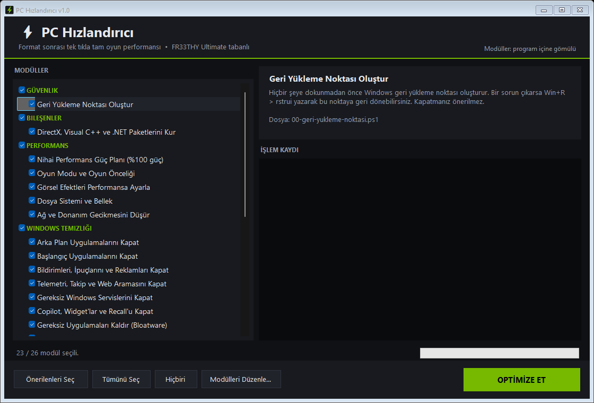

<p align="center">
  
</p>

<h1 align="center">PC Hızlandırıcı</h1>

<p align="center">
  <b>Format sonrası tek tıkla tam oyun performansı.</b><br>
  Windows 10 / 11 için açık kaynaklı, düzenlenebilir oyun optimizasyon aracı.<br>
  <a href="https://github.com/FR33THYFR33THY/Ultimate">FR33THY Ultimate</a> tabanlıdır.
</p>

<p align="center">
  
</p>

---

## Hızlı başlangıç

1. **[Releases](../../releases/latest)** sayfasından `PCHizlandirici.exe` dosyasını indirin.
2. Çift tıklayın ve yönetici izni verin.
3. Önerilen ayarlar zaten seçili. **OPTİMİZE ET**'e basın.
4. İşlem bitince bilgisayarı yeniden başlatın.

Ya da yönetici olarak açtığınız PowerShell'e şunu yapıştırın (indirip açar):

```powershell
irm https://github.com/farmex441-temp/PC-Hizlandirici/releases/latest/download/PCHizlandirici.exe -OutFile "$env:TEMP\PCHizlandirici.exe"; & "$env:TEMP\PCHizlandirici.exe"
```

> **Windows SmartScreen uyarısı:** Program dijital olarak imzalı olmadığı için "Windows bilgisayarınızı korudu" uyarısı çıkabilir. **Ek bilgi → Yine de çalıştır** deyin. Kaynak kodun tamamı bu depodadır; `build.ps1` ile kendiniz de derleyebilirsiniz.

### Önerilen sıra (format sonrası)

1. Windows kurulumunu bitirin, internete bağlanın.
2. **Ekran kartı sürücüsünü kurun** (NVIDIA ayarlarının uygulanabilmesi için gerekli).
3. PC Hızlandırıcı'yı çalıştırın → OPTİMİZE ET → yeniden başlatın.

---

## Ne yapar?

Her madde ayrı bir modüldür; arayüzde istediğinizi seçip istemediğinizi kaldırabilirsiniz.

| Kategori | Modül | Varsayılan |
|---|---|:---:|
| Güvenlik | **Geri yükleme noktası** oluşturur (her şeyden önce) | ✅ |
| Bileşenler | **DirectX, Visual C++ 2005-2022 (x86+x64), .NET Framework 3.5, .NET Desktop Runtime 8 + 10, XNA 4.0** — hepsi resmi Microsoft sunucularından, imzası doğrulanarak | ✅ |
| Performans | **Nihai Performans güç planı** — CPU %100, çekirdek park yok, USB/PCIe/disk güç tasarrufu yok, uyku/hazırda bekletme/hızlı başlatma yok, power throttling yok | ✅ |
| Performans | **Oyun Modu**, Game DVR kapalı, **HAGS** açık, pencereli oyun iyileştirmesi, oyunlara CPU/GPU önceliği, fare ivmesi kapalı, Yapışkan Tuşlar uyarısı kapalı | ✅ |
| Performans | **Görsel efektler** performans modunda (yazı yumuşatma korunur) | ✅ |
| Performans | **Dosya sistemi / bellek** — NTFS son erişim kapalı, 8.3 adları kapalı, TRIM açık, SSD'de SysMain kapalı | ✅ |
| Performans | **Ağ ve donanım gecikmesi** — Nagle kapalı, Enerji Verimli Ethernet kapalı, aygıt güç tasarrufu kapalı, P2P güncelleme paylaşımı kapalı | ✅ |
| Windows Temizliği | **Arka plan uygulamaları** kapalı | ✅ |
| Windows Temizliği | **Başlangıç uygulamaları** kapalı (Görev Yöneticisi'nden geri açılabilir) | ✅ |
| Windows Temizliği | **Bildirimler**, ipuçları, öneriler, reklamlar, otomatik uygulama kurulumu kapalı | ✅ |
| Windows Temizliği | **Telemetri**, reklam kimliği, etkinlik geçmişi, Başlat'taki Bing araması kapalı | ✅ |
| Windows Temizliği | **Gereksiz servisler** kapalı / el ile (yazıcı, Bluetooth, ses, Xbox, güvenlik servislerine dokunulmaz) | ✅ |
| Windows Temizliği | **Copilot, Widget'lar, Recall** kapalı | ✅ |
| Windows Temizliği | **Bloatware** kaldırılır (Clipchamp, Haberler, Solitaire, Teams, Outlook (yeni), Candy Crush, TikTok…) | ✅ |
| Windows Temizliği | **OneDrive** kaldırılır (klasörleriniz OneDrive'a yedekleniyorsa güvenlik için atlanır) | ✅ |
| Windows Temizliği | **Edge** sadeleştirilir (arka planda çalışmaz, kenar çubuğu/reklam yok) | ✅ |
| Windows Temizliği | **Windows Update** oyuncu dostu (güncellemeler açık kalır, zorla yeniden başlatma yok) | ✅ |
| Görünüm | **Karanlık mod**, saydamlık kapalı | ✅ |
| Görünüm | **Başlat menüsü** temizlenir (boş sabitlemeler, öneriler yok) | ✅ |
| Görünüm | **Görev çubuğu** temizlenir (arama, Görev Görünümü, Widget, Copilot düğmeleri yok; "Görevi sonlandır" eklenir) | ✅ |
| Görünüm | **Dosya Gezgini** — uzantılar görünür, klasik sağ tık menüsü | ✅ |
| Ekran Kartı | **NVIDIA %100 performans profili** — FR33THY Ultimate ile aynı ayarlar, NVIDIA Profile Inspector ile (aşağıya bakın) | ✅ |
| Gelişmiş (Risk) | Çekirdek yalıtımı / VBS kapat (+%5-10 FPS, güvenlik katmanı azalır) | ⬜ |
| Gelişmiş (Risk) | Xbox uygulamaları ve Game Bar'ı kaldır (Game Pass oyunları çalışmaz) | ⬜ |
| Gelişmiş (Risk) | Windows Update sürücü güncellemelerini engelle | ⬜ |
| Bakım | **Disk temizliği** — geçici dosyalar, güncelleme önbelleği, geri dönüşüm kutusu | ✅ |

### NVIDIA ayarları

[NVIDIA Profile Inspector](https://github.com/Orbmu2k/nvidiaProfileInspector) resmi GitHub sürümünden indirilir ve genel profile şunlar uygulanır:

| Ayar | Değer |
|---|---|
| Güç yönetimi modu | Maksimum performans tercih et |
| Düşük gecikme modu | Ultra |
| Maksimum önceden işlenmiş kare | 1 |
| Doku filtreleme kalitesi | Yüksek performans |
| Dikey senkronizasyon | Zorla kapalı |
| G-SYNC | Kapalı |
| Gölgelendirici önbellek boyutu | Sınırsız |
| İş parçacıklı iyileştirme | Açık |
| Tercih edilen yenileme hızı | En yüksek |
| Kare hızı sınırlayıcı | Kapalı |

Ayrıca PhysX GPU'ya alınır, MSI kesme modu açılır, NVIDIA telemetrisi kapatılır. **G-SYNC monitörünüz varsa** ve kullanmak istiyorsanız NVIDIA Denetim Masası'ndan tekrar açabilirsiniz.

### Bilerek YAPMADIKLARI

Bu araç başkalarının da kullanacağı genel bir araç olduğu için şunlara **dokunmaz**: Windows Defender, güvenlik duvarı, UAC, Spectre/Meltdown korumaları, DEP ve Windows güncellemelerinin kendisi. Bunları kapatmak FPS'e anlamlı bir katkı yapmaz ama bilgisayarı ciddi şekilde savunmasız bırakır. İhtiyacınız varsa orijinal betikler [`ultimate-original/`](ultimate-original) klasöründe durur.

---

## Düzenleme (kendi ayarlarınızı ekleyin)

Program, modülleri `.ps1` dosyaları olarak içinde taşır. Düzenlemek için iki yol var:

**1. Derlemeden düzenleme:** Arayüzde **Modülleri Düzenle…** düğmesine basın. Exe'nin yanına bir `modules` klasörü çıkarılır. Buradaki dosyaları değiştirin, silin veya yeni `.ps1` ekleyin. Program her açılışta bu klasörü kullanır.

**2. Kaynaktan derleme:** Depoyu indirin, `modules/` klasörünü düzenleyin ve:

```powershell
powershell -ExecutionPolicy Bypass -File build.ps1
```

Çıktı: `dist\PCHizlandirici.exe`. Visual Studio veya .NET SDK gerekmez; her Windows'ta bulunan derleyici kullanılır.

### Yeni modül yazmak

`modules/` içine `NN-ad.ps1` adında bir dosya oluşturun (`NN` çalışma sırasını belirler). Başına şu başlığı ekleyin:

```powershell
# @name: Modülün arayüzde görünen adı
# @category: Performans
# @default: true
# @desc: Arayüzde gösterilecek açıklama.

Set-Reg 'HKCU:\Software\Ornek' 'Deger' 1          # kayıt defteri (DWord)
Set-Reg 'HKCU:\Software\Ornek' 'Yazi' 'abc' String
Set-ServiceStart 'ServisAdi' 'Disabled'            # Disabled | Manual | Automatic
Disable-Task '\Microsoft\Windows\Klasor\' 'GorevAdi'
Remove-AppxSafe 'Microsoft.UygulamaAdi'
Ok 'Bitti'                                          # yeşil satır
Warn 'Dikkat'                                       # sarı satır
Request-ExplorerRestart                             # işlem sonunda Explorer yenilensin
```

Tüm yardımcı fonksiyonlar [`modules/_lib.ps1`](modules/_lib.ps1) içindedir.

### Komut satırı

| Parametre | Açıklama |
|---|---|
| `/auto` | Önerilen modülleri hiç soru sormadan uygular |
| `/auto /reboot` | Uygular ve otomatik yeniden başlatır |
| `/list dosya.txt` | Modül listesini dosyaya yazar |

---

## Geri alma

* İlk modül bir **geri yükleme noktası** oluşturur. Bir sorun olursa `Win + R` → `rstrui` → "PC Hizlandirici oncesi" noktasını seçin.
* Başlangıç uygulamaları: Görev Yöneticisi → Başlangıç uygulamaları.
* İşlem kayıtları: `C:\ProgramData\PCHizlandirici\logs\`

## Proje yapısı

```
src/Program.cs        Arayüz ve modül çalıştırıcı (C#, .NET Framework 4.8)
src/app.manifest      Windows manifesti
modules/_lib.ps1      Modüllerin ortak fonksiyonları
modules/NN-*.ps1      Optimizasyon modülleri (exe içine gömülür)
assets/               Simge ve ekran görüntüsü
build.ps1             Derleme betiği
ultimate-original/    FR33THY/Ultimate deposunun orijinal kopyası (MIT)
```

## Teşekkür ve lisans

Bu proje [FR33THY/Ultimate](https://github.com/FR33THYFR33THY/Ultimate) (MIT, © FR33THY) üzerine kurulmuştur; NVIDIA profil ayarları, güç planı değerleri ve Başlat menüsü düzeni oradan alınmıştır. NVIDIA ayarları için [NVIDIA Profile Inspector](https://github.com/Orbmu2k/nvidiaProfileInspector) kullanılır.

MIT Lisansı — ayrıntılar için [LICENSE](LICENSE) dosyasına bakın. Yazılım "olduğu gibi" sunulur; kullanım sorumluluğu kullanıcıya aittir.
